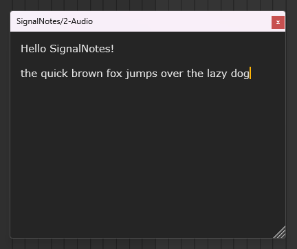
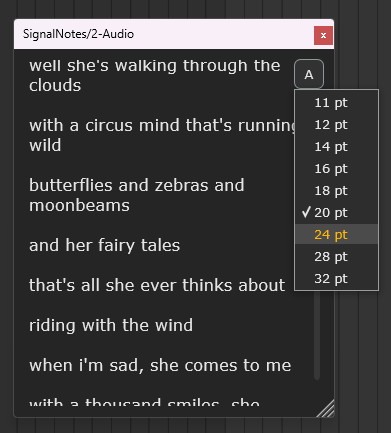

## SignalNotes

**a simple notepad plugin for music producers**

Welcome to the first part of my journey into audio plugin development.
I plan to keep building until I create my own reverb.

## about

I wanted a place to keep track of my thoughts and reasoning when working
with signal chains in Ableton Live. This led me to create my first plugin:
SignalNotes.

SignalNotes is a simple notepad plugin designed with Ableton Live in mind.
It provides a space to document production ideas, signal chains, lyrics, or
even the occasional journal entry (if you're like that).

This project was largely inspired by Logic Pro's built-in notepad
functionality and the lack of an equivalent feature in Ableton Live.

## features

- Multiline text editing
- Resizable plugin window
- Resizable text editor
- Dark writing interface
- Adjustable font size
- Independent note per plugin instance

_more features are planned_

## development

SignalNotes is my first hands-on introduction to the JUCE framework and C++
audio plugin development.

Rather than immediately jumping into digital signal processing and audio
manipulation, I wanted to start with something relatively simple. Building
a notepad gave me an opportunity to understand the structure of an audio
plugin, its processor and editor, and how it interacts with a DAW.

I wanted to become comfortable with these tools before introducing the
additional complexity of audio processing and DSP mathematics.

This project is also the beginning of a longer learning journey. My eventual
goal is to develop my own audio effects, starting with simpler processors
and working toward building a reverb.

## images

## project status

SignalNotes is currently a work in progress. Features and improvements are
being developed as I continue learning JUCE and C++.
